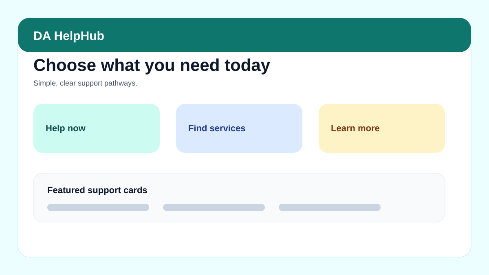
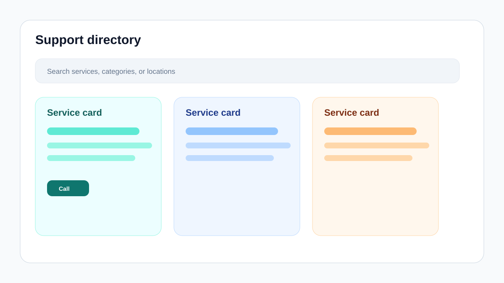

# HelpHub AU / DA HelpHub

HelpHub AU is a mobile-first support services finder built with Next.js, TypeScript, and Tailwind.

It is designed to make support information easier to browse, with simple mode, public mode, service categories, saved items, and direct call/website actions.

---

## Screenshots

These are generated SVG screenshot mockups. Replace them later with real app screenshots if you want exact captures.





Screenshot guide:

```text
docs/screenshots/README.md
```

---

## Main features

- Simple mode for calm, low-stress use.
- Full mode for advanced browsing and filtering.
- Support service directory.
- Courses and programs page.
- Saved help and support log concepts.
- Accessibility controls.
- Quick exit behaviour.
- Public mode and optional dev/admin mode.
- Local static data in `lib/data.ts`.
- Placeholder ingestion primitives for future data importing.

---

## Home Assistant add-on / GHCR image

This repo builds a container image for Home Assistant through GitHub Actions.

Image:

```text
ghcr.io/you209/da-helphub:1.0.0
```

Home Assistant wrapper repo:

```text
https://github.com/you209/HA-OS-all
```

Wrapper folder:

```text
HA-OS-all/da_helphub/
```

Default app port inside container:

```text
3000/tcp
```

Typical mapped port in Home Assistant:

```text
3002
```

---

## Running locally

### Requirements

- Node.js 20+
- npm 10+

### Development server

```bash
npm install
npm run dev
```

Open:

```text
http://localhost:3000
```

### Production build

```bash
npm run build
npm run start
```

---

## Docker build

```bash
docker build -t da-helphub .
docker run --rm -p 3000:3000 da-helphub
```

Open:

```text
http://localhost:3000
```

---

## GitHub Actions build

Workflow:

```text
.github/workflows/ghcr.yml
```

Expected output images:

```text
ghcr.io/you209/da-helphub:1.0.0
ghcr.io/you209/da-helphub:latest
```

For Home Assistant, versioned tags are preferred over `latest`.

---

## Updating the Home Assistant image

1. Change code in this repo.
2. Run the GHCR GitHub Actions workflow.
3. If the image tag changes, update `HA-OS-all/da_helphub/config.yaml`.
4. In Home Assistant, run `ha addons reload`.
5. Check for updates in the Add-on Store.
6. Update/reinstall the add-on if needed.

---

## Public mode and admin mode

The app can show different behaviour depending on environment settings.

For local dev/admin behaviour:

```bash
NEXT_PUBLIC_DEV_MODE=true
```

If not set, the app should behave as a public-facing content-only support hub.

---

## Data

Core service data is currently stored in:

```text
lib/data.ts
```

Seed CSV data is stored at:

```text
data/imports/helphub_services_seed.csv
```

---

## Project structure

```text
app/
components/
lib/
data/
  imports/
docs/
  screenshots/
    home.svg
    support-directory.svg
```

---

## Safety note

This app should only provide general support-directory information and links to official services. It should not replace emergency services, legal advice, medical advice, or specialist support.
